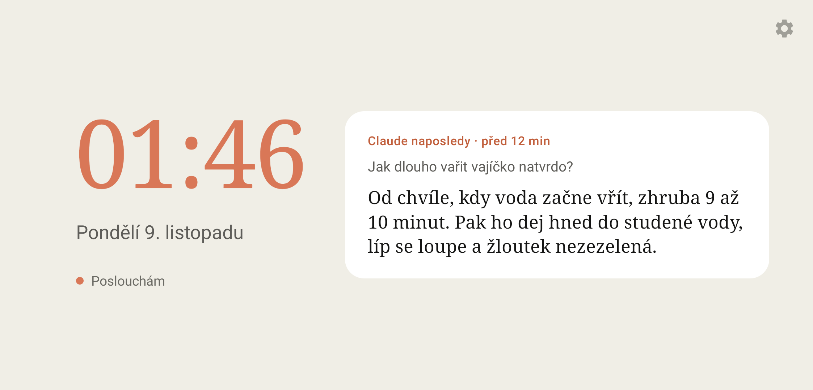

# Hey Claude on an old phone

An old Android phone as a voice assistant for the wall or a desk. It shows a clock and Claude's last answer. Say "Hey Claude" and the phone opens the Claude app and turns on voice mode by itself.

Unofficial project, not affiliated with Anthropic. It relies on the "Voice mode" button in the Claude app: if Claude renames or hides it, adjust `VOICE_BUTTON` in `Config.kt`.

The app's own texts are localized: English by default, Czech when the phone language is Czech.



## How it works

1. **Offline wake word.** [Vosk](https://alphacephei.com/vosk/) with a small English model is only allowed to recognize "hey" and "claude", so no audio leaves the phone. The display edge glows orange while someone is speaking, green on "Hey Claude" and red when it heard only "Claude" or wasn't sure.
2. **Voice mode.** The assistant releases the microphone, opens Claude in a new conversation (link `https://claude.ai/new`) and the accessibility service taps "Voice mode". It finds the button by its name, so it works in portrait and landscape. Tapping the clock does the same.
3. **Back to the clock.** When Claude is silent for 15 seconds and no new text appears in the chat (after 15 minutes at the latest), the service ends the call, reads the last question and answer from the chat and keeps them on the display for 12 hours. They are stored only on the phone.
4. **Settings.** Gear icon in the top right: new or last conversation, silence timeout 15 s, 30 s or 1 min, light or dark theme (light for the white holder, dark for the black one), and a button that opens Claude without a call (for its settings or sign-in).

## Volume, printing and scanning from a call

The Claude app can't call local MCP servers, only connectors with a public address. So the assistant can be an MCP server itself: it keeps a connection to a small relay on Cloudflare and Claude changes the phone's volume through it during a call. Printing and scanning on a Wi-Fi printer are written but not yet verified on a real printer. Any other tool can be added. It's optional; deployment and connector setup are described in [`connector/README.md`](connector/README.md).

## Custom screen by voice

With the connector you design the home screen during a call: "put a big clock and the bitcoin price there". Claude writes a page, the phone stores it and shows it instead of the clock until you ask for another one or say "bring back the clock". It appears after the call ends. Public data (exchange rates, stock prices) is fetched by the phone behind the page every minute, so it stays live. Data from other connectors on claude.ai doesn't reach the phone and stays as a snapshot from the moment of the call. It works from a voice call too. Claude only edits the page: it may write it only after reading the current one, and instead of the original clock it gets a copy of it as a page (`res/raw/clock.html`). It writes a completely new one only when you explicitly ask.

You can try a page without Claude:

```bash
adb push page.html /sdcard/Android/data/cz.magiak.asistent/files/screen.html
adb shell am start -n cz.magiak.asistent/.MainActivity --es demo screen
```

`--es demo clock` brings back the clock. The page has `await asistent.json(url)` and `await asistent.text(url)` (fetched by the phone, no CORS restrictions) and `asistent.lastAnswer()`.

## Meeting

"Hey Claude, record the meeting" (or the button in settings) starts recording a meeting. The assistant stays silent and records the whole meeting on the phone. Roughly every 2 to 3 minutes it sends a chunk, cut at a pause, to [ElevenLabs Scribe v2](https://elevenlabs.io/docs/capabilities/speech-to-text) for transcription with speaker labels. "Hey Claude" and a question: the phone transcribes the rest, sends the whole transcript with the question to Claude through the API and reads a short answer in the phone's voice. "Hey Claude, end the meeting" ends the meeting and Claude writes a summary with decisions and tasks.

The meeting is summarized in the phone's language, and the spoken voice uses it too.

The transcript and summary are on the phone in `meetings/<date>/` next to the recording. During a call the connector's "Meetings" tool finds them: "what did we decide at the last meeting?".

It needs two keys in `android/local.properties`: `elevenlabs.key` and `anthropic.key` (a key from console.anthropic.com, not the Claude app subscription). Meeting audio goes to ElevenLabs and the transcript to Anthropic, so at someone else's meeting ask the person who runs it.

You can check the keys with one call to each service, the result is in `adb logcat -s Assistant`:

```bash
adb shell am start -n cz.magiak.asistent/.MainActivity --es meeting keys
```

Without keys and without audio, the whole meeting can be tried on a recording (16 kHz mono WAV, offline English transcription, trial answers):

```bash
adb push meeting.wav /sdcard/Android/data/cz.magiak.asistent/files/meeting.wav
adb shell am start -n cz.magiak.asistent/.MainActivity --es meeting start --ez dry_run true --es file /sdcard/Android/data/cz.magiak.asistent/files/meeting.wav --ef speed 2
```

## Requirements

- A phone with Android 8 or newer and the Play Store, permanently on a charger. Verified on an ASUS ZenFone 5Z with Android 10.
- A battery that isn't swollen. If the phone supports it, turn on charge limiting (Pixel 6a and newer 80 %, Samsung 85 %).
- A Pixel gives the least trouble. ASUS, Xiaomi, Huawei and others need the Assistant allowed in auto-start, otherwise the accessibility service doesn't run after a restart.
- The holder is only for the ZenFone 5Z. For another phone, change the dimensions at the top of `holder/holder.py`.
- A signed-in Claude app. Verified with the English interface.
- To build: Android SDK and JDK 17. The build downloads the Vosk model itself.
- For tools in a call, also Node.js and a Cloudflare account (the Free plan is enough).
- For meetings, a key for ElevenLabs and for the Anthropic API.

## Installation

Connect the phone over USB with USB debugging on:

```bash
cd android
./gradlew installDebug
```

After installing, start the app only with `adb shell am start -n cz.magiak.asistent/.MainActivity`. `am force-stop` turns off the accessibility service. If `adb shell dumpsys accessibility` doesn't list it under "Bound services", the installation killed it mid-start: install again.

## Phone setup

1. **Microphone:** allow it for the Assistant on first launch.
2. **Accessibility service:** long-press the clock, the accessibility settings open. Tap Assistant, turn it on and confirm.
3. **Auto-start:** on an ASUS, allow the Assistant in the Auto-start Manager app (other vendors have a similar setting). Without it the service stays enabled in settings after a restart or update but doesn't run. The display then says so.
4. **Home screen:** press Home, choose Assistant and "Always". After a restart it goes straight to the clock.
5. **Screen lock** is better turned off: the clock shows over the lock, Claude doesn't.

The app keeps the display on itself and dims the brightness from 22:00 to 7:00. Media volume controls both Claude's voice and the beep after "Hey Claude".

## Tuning

Phrases, confidence threshold, glow colours, beeps and night brightness are in [`Config.kt`](android/app/src/main/java/cz/magiak/asistent/Config.kt). The screen look is in [`activity_main.xml`](android/app/src/main/res/layout/activity_main.xml), the margins matching the holder window in [`dimens.xml`](android/app/src/main/res/values/dimens.xml).

You can tune the wake word to your voice from one recording. Start recording, tap the display and for a minute and a half do what it says:

```bash
adb shell am start -n cz.magiak.asistent/.MainActivity --es demo record
```

Then on the computer pull the recording and compare thresholds (recordings stay in `tuning/recordings/`, they don't go to git):

```bash
uv run tuning/evaluate.py --pull
```

If the voice mode button isn't found, `python adb_test.py --explore` opens Claude and lists all buttons on the screen.

## Holder

`holder/` is a 3D-printable holder for the ASUS ZenFone 5Z in landscape, for the wall and for a desk. `holder.3mf` is a Bambu Studio project, `stl/` holds the separate parts and `holder.py` is the generator (phone dimensions at the top of the file, needs `numpy trimesh manifold3d matplotlib`). The body and cover are joined by 4 M2.5×10 countersunk screws. For desk use, a rail with a folding leg is screwed on under the top two screws, and the leg is held by another 2 M2.5×10 screws from the side. For the wall, the rail is unscrewed and the cover hangs on two screws. The cable exits at the back near the bottom edge, you need an angled USB-C cable.

## License

MIT. The Vosk model is downloaded separately under its own license.
