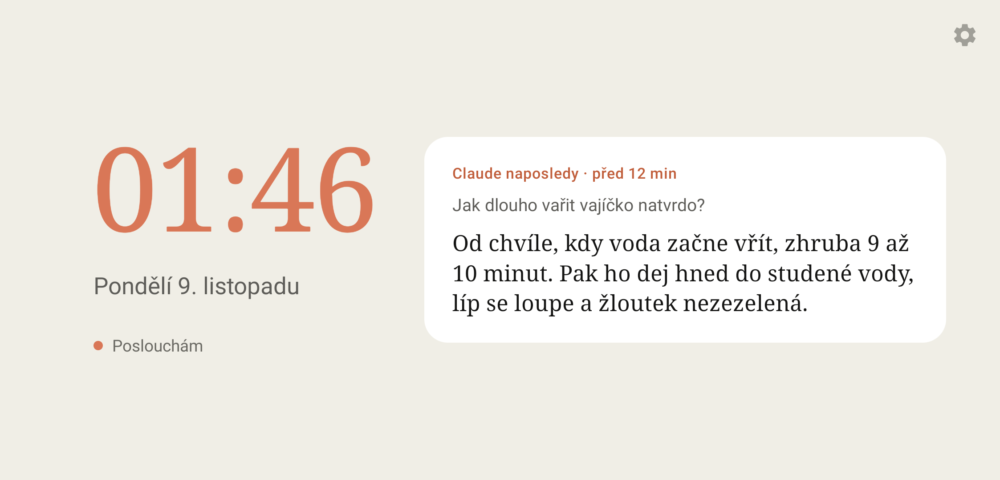

# Hey Claude na starém telefonu

Starý Android telefon jako hlasový asistent na zeď nebo na stůl. Ukazuje hodiny a poslední odpověď Clauda. Řekneš „Hey Claude“ a telefon otevře aplikaci Claude a sám zapne hlasový režim.

Neoficiální projekt, s Anthropic nesouvisí. Spoléhá na tlačítko „Voice mode“ v aplikaci Claude: když ho Claude přejmenuje nebo schová, stačí upravit `VOICE_BUTTON` v `Config.kt`.



## Jak to funguje

1. **Budicí slovo offline.** [Vosk](https://alphacephei.com/vosk/) s malým anglickým modelem smí rozpoznat jen „hey“ a „claude“, zvuk z telefonu nikam neodchází. Okraj displeje svítí oranžově, když někdo mluví, zeleně na „Hey Claude“ a červeně, když slyšel jen „Claude“ nebo si nebyl jistý.
2. **Hlasový režim.** Asistent pustí mikrofon, otevře Clauda a služba přístupnosti klepne na „Voice mode“. Tlačítko hledá podle názvu, takže funguje na výšku i na šířku. Klepnutí na hodiny dělá totéž.
3. **Návrat na hodiny.** Když se hovor minutu nehýbe (nejdéle po 15 minutách), služba ho ukončí, přečte z chatu poslední otázku a odpověď a nechá je na displeji 12 hodin. Uložené jsou jen v telefonu.

## Hlasitost, tisk a sken z hovoru

Aplikace Claude neumí volat lokální MCP servery, jen konektory s veřejnou adresou. Asistent proto může být MCP serverem sám: drží spojení s malým průchodem na Cloudflare a Claude přes něj v hovoru mění hlasitost telefonu. Tisk a sken na tiskárně v Wi-Fi jsou napsané, na skutečné tiskárně zatím neověřené. Přidat jde jakýkoliv další nástroj. Je to volitelné, nasazení a nastavení konektoru popisuje [`konektor/README.md`](konektor/README.md).

## Co je potřeba

- Telefon s Androidem 8 nebo novějším, trvale v nabíječce.
- Přihlášená aplikace Claude. Ověřeno s anglickým rozhraním.
- Na sestavení Android SDK a JDK 17. Model Vosk si sestavení stáhne samo.
- Pro nástroje v hovoru navíc Node.js a účet na Cloudflare (stačí Free plán).

## Instalace

Telefon připoj přes USB se zapnutým laděním USB:

```bash
cd android
./gradlew installDebug
```

Po instalaci aplikaci spouštěj jen `adb shell am start -n cz.magiak.asistent/.MainActivity`. `am force-stop` vypne službu přístupnosti.

## Nastavení telefonu

1. **Mikrofon:** při prvním spuštění ho Asistentovi povol.
2. **Služba přístupnosti:** podrž prst na hodinách, otevře se nastavení přístupnosti. Klepni na Asistent, zapni ho a potvrď.
3. **Automatické spouštění:** na ASUSu v aplikaci Auto-start Manager povol Asistenta (jiní výrobci mívají podobné nastavení). Bez toho služba po restartu nebo aktualizaci zůstane v nastavení zapnutá, ale neběží. Displej to pak napíše.
4. **Domovská obrazovka:** stiskni Domů, vyber Asistent a „Vždy“. Po restartu naběhne rovnou do hodin.
5. **Zámek obrazovky** raději vypni: hodiny se přes zámek ukážou, Claude ne.

Displej drží rozsvícený aplikace sama, od 22 do 7 hodin ztlumí jas. Hlasitost médií řídí hlas Clauda i pípnutí po „Hey Claude“.

## Ladění

Fráze, práh jistoty, barvy záře, pípnutí a noční jas jsou v [`Config.kt`](android/app/src/main/java/cz/magiak/asistent/Config.kt). Vzhled obrazovky je v [`activity_main.xml`](android/app/src/main/res/layout/activity_main.xml), okraje podle okénka držáku v [`dimens.xml`](android/app/src/main/res/values/dimens.xml).

Naladit budicí slovo na svůj hlas jde z jedné nahrávky. Spusť nahrávání, klepni na displej a minutu a půl dělej, co říká:

```bash
adb shell am start -n cz.magiak.asistent/.MainActivity --es ukazka nahraj
```

Pak v počítači stáhni nahrávku a porovnej prahy (nahrávky zůstávají v `ladeni/nahravky/`, do gitu nejdou):

```bash
uv run ladeni/vyhodnot.py --stahni
```

Když se tlačítko hlasového režimu nenajde, `python adb_test.py --pruzkum` otevře Clauda a vypíše všechna tlačítka na obrazovce.

## Držák

`drzak/` je 3D tisknutelný držák pro ASUS ZenFone 5Z na šířku, na zeď i na stůl. `asistent_drzak.3mf` je projekt pro Bambu Studio, `stl/` jsou samostatné díly a `drzak.py` je generátor (rozměry telefonu nahoře v souboru, potřebuje `numpy trimesh manifold3d matplotlib`). Tělo a víčko spojují 4 šroubky M2,5×10 se zápustnou hlavou, na zeď visí víčko na dvou šroubech. Potřebuješ úhlový kabel USB-C.

## Licence

MIT. Model Vosk se stahuje zvlášť pod vlastní licencí.
